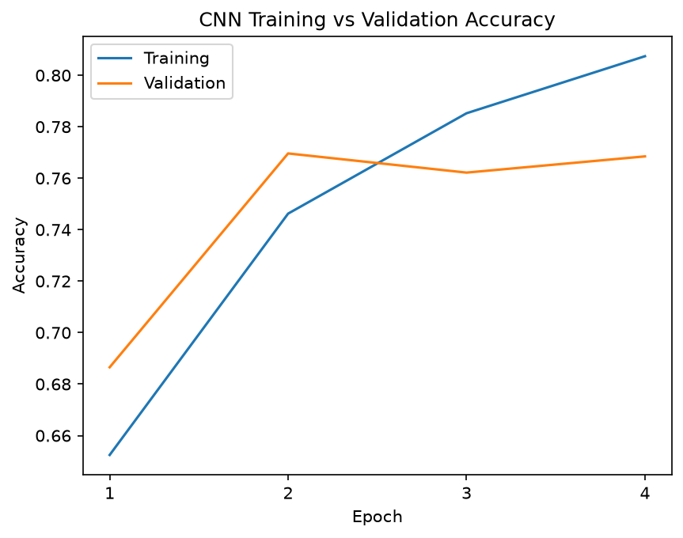
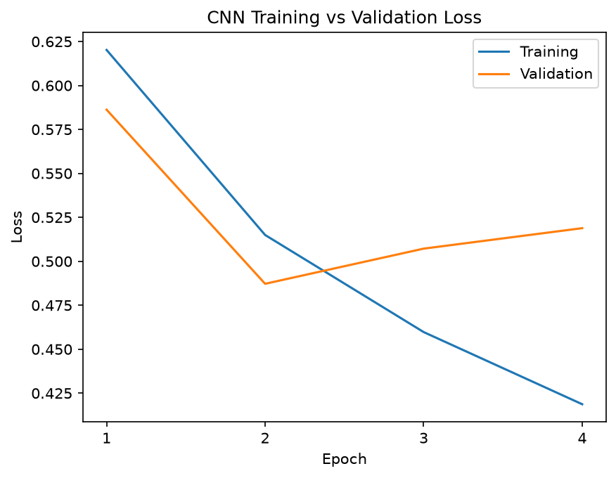
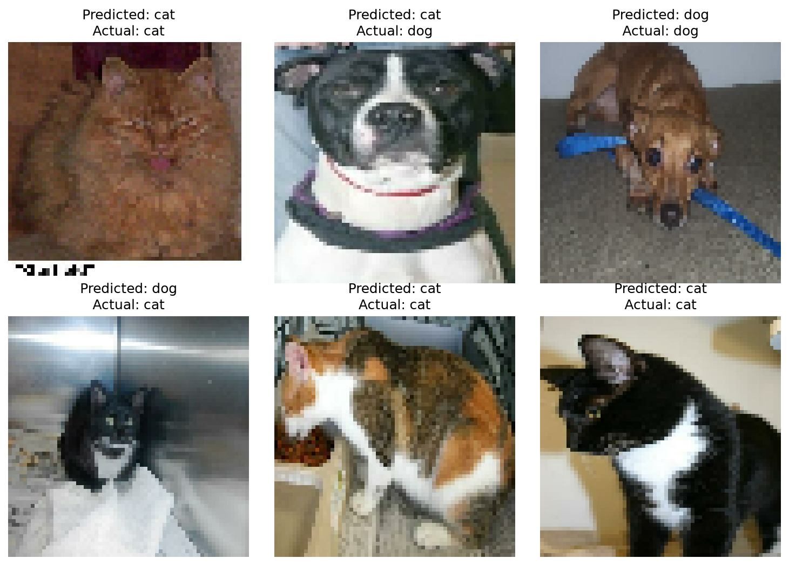

# Cat vs. Dog Image Classification using CNN

A binary image classifier built with Python and TensorFlow. The model uses a Convolutional Neural Network (CNN) to classify images as either cats or dogs.


## Model Architecture

The CNN processes 64×64 RGB images using:

- Two convolutional layers with 32 and 64 filters
- Max pooling to reduce spatial dimensions
- A flattening layer followed by 128 dense neurons
- Dropout (0.5) to help reduce overfitting
- A sigmoid output for binary classification

## Dataset and Training

Uses the TensorFlow Datasets `cats_vs_dogs` dataset, containing 23,262 usable images.

- Training: 70%
- Validation: 15%
- Testing: 15%
- Optimizer: Adam
- Loss: Binary cross-entropy
- EarlyStopping based on validation loss

## Results

The model achieved **77.36% test accuracy** with a test loss of **0.4716** in the evaluated run.

Training and validation curves were used to examine model performance and identify signs of overfitting.

## Visualizations

### Accuracy



### Loss



### Sample Predictions



## Running the Project

Install dependencies:

```bash
python -m pip install -r requirements.txt
```

Run:

```bash
python main.py
```

The program trains the CNN, saves the model and produces evaluation graphs and sample predictions.

## Technologies

Python, TensorFlow, Keras, TensorFlow Datasets and Matplotlib.
